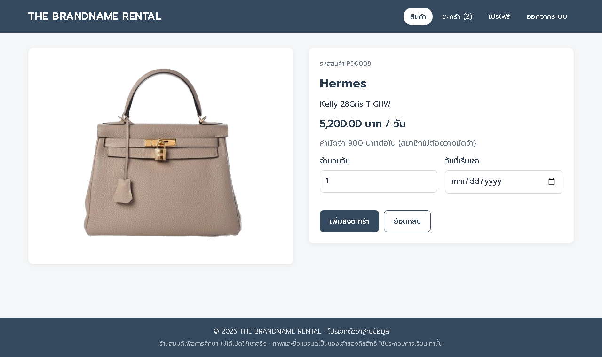
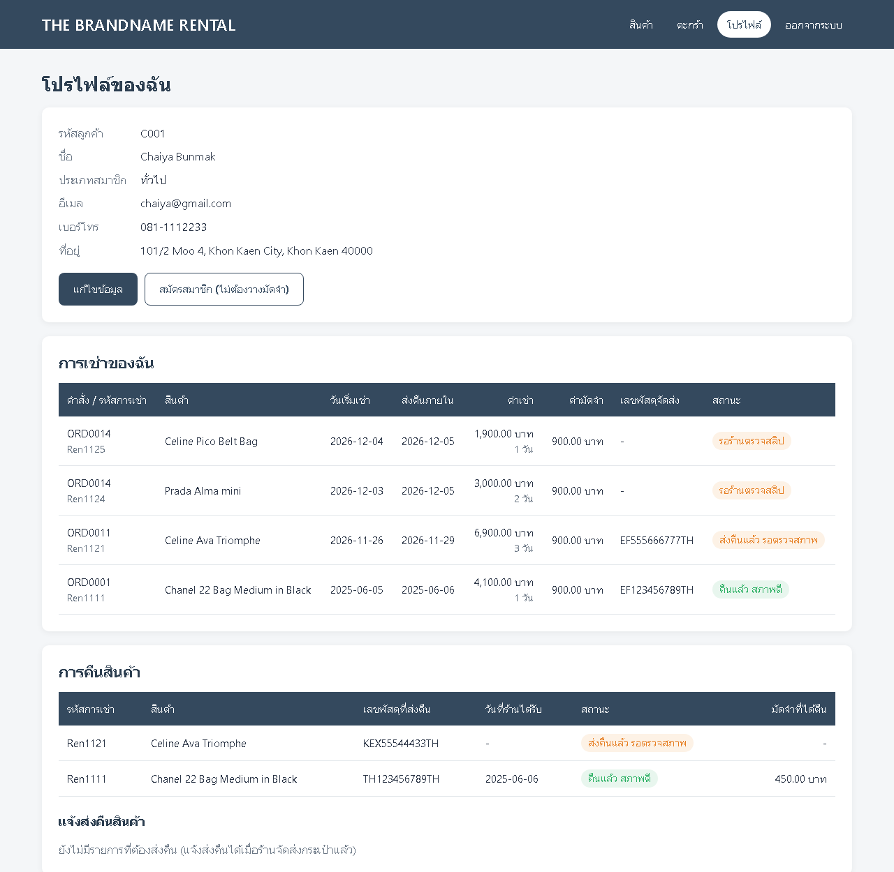
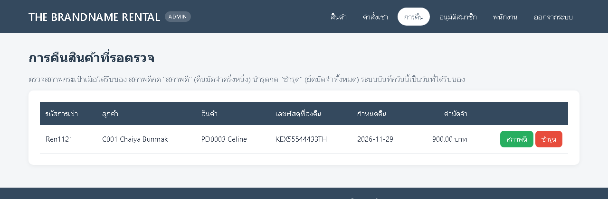
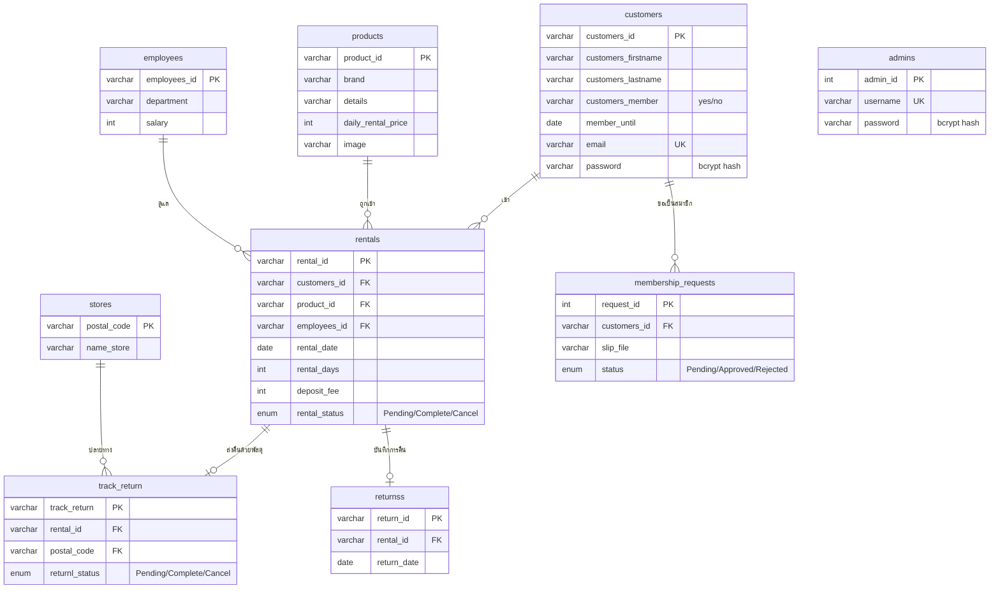

# THE BRANDNAME RENTAL — ระบบเช่ากระเป๋าแบรนด์เนม

เว็บแอปร้านเช่ากระเป๋าแบรนด์เนม พัฒนาด้วย **PHP + MySQL** ต่อยอดจากโปรเจกต์วิชาฐานข้อมูล (งานที่สั่งเป็นระบบ Python + MySQL ส่วนเว็บ PHP นี้พัฒนาเพิ่มเอง) แล้วนำมาปรับปรุงต่อทั้งด้านความปลอดภัย ความถูกต้องของข้อมูล และโครงสร้างโค้ด

**ลองเล่นเว็บเดโม:** https://brandname-rental-demo.infinityfreeapp.com (บัญชีทดลองอยู่บนแถบด้านบนของเว็บ ข้อมูลรีเซ็ตทุกวัน)

> ร้านสมมติเพื่อการศึกษา ไม่ได้เปิดให้เช่าจริง ภาพและชื่อแบรนด์เป็นของเจ้าของลิขสิทธิ์ ใช้ประกอบการเรียนเท่านั้น


## ฟีเจอร์

**ฝั่งลูกค้า**
- ค้นหาและดูรายละเอียดกระเป๋า เลือกวันที่เริ่มเช่าและจำนวนวัน (1–30 วัน)
- ตะกร้าสินค้าที่คำนวณค่าเช่าและค่ามัดจำจากฐานข้อมูลทุกครั้ง
- ชำระเงินผ่าน QR แล้วรอร้านยืนยัน
- สมัครสมาชิกรายปีโดยแนบสลิป สมาชิกไม่ต้องวางมัดจำ
- ติดตามสถานะการเช่า แจ้งเลขพัสดุส่งคืน และดูยอดมัดจำที่ได้คืน

**ฝั่งร้าน (แอดมิน)**
- ยืนยันหรือยกเลิกคำสั่งเช่า พร้อมยอดที่ต้องได้รับ
- ตรวจสภาพของที่ส่งคืน: สภาพดีคืนมัดจำครึ่งหนึ่ง ชำรุดร้านยึดมัดจำทั้งหมด
- ดูสลิปและอนุมัติสมาชิก (มีอายุ 1 ปีนับจากวันอนุมัติ)
- เพิ่มสินค้าพร้อมรูป และจัดการข้อมูลพนักงาน

| หน้าสินค้า | ตะกร้า |
|---|---|
|  |  |
| **โปรไฟล์และสถานะการเช่า/คืน** | **แอดมิน: ตรวจการคืนสินค้า** |
|  |  |

## กติกาของร้าน

| เรื่อง | กติกา |
|---|---|
| ค่ามัดจำ | ลูกค้าทั่วไป 900 บาทต่อใบ · สมาชิก 0 บาท |
| สมาชิก | 3,000 บาท อายุ 1 ปีนับจากวันที่ร้านอนุมัติสลิป |
| คืนสินค้า | สภาพดีคืนมัดจำครึ่งหนึ่ง · ชำรุดร้านยึดมัดจำทั้งหมด |
| ราคารวม | ค่าเช่ารายวัน × จำนวนวัน + ค่ามัดจำ |

## ฐานข้อมูล

ออกแบบตามหลัก Normalization (รายละเอียดในรายงานวิชา และไฟล์ MySQL Workbench `database/project.mwb`)



## สิ่งที่ปรับปรุงจากเวอร์ชันแรก

ประวัติใน git แยกเป็น 3 ขั้น: เว็บเวอร์ชันแรก → รอบ 1 ความปลอดภัยและบั๊ก → รอบ 2 โครงสร้างโค้ด

**ความปลอดภัย**
| ปัญหาในเวอร์ชันเดิม | วิธีแก้ |
|---|---|
| หน้าแอดมิน 4 หน้าเปิดได้โดยไม่ต้องล็อกอิน | ทุกหน้าในโฟลเดอร์ `admin/` เรียก `require_admin()` |
| รหัสแอดมินเขียนตายตัวในโค้ด | ย้ายไปตาราง `admins` เก็บรหัสผ่านแบบ hash |
| SQL Injection ในหน้าสินค้าและหน้าเพิ่มพนักงาน | ใช้ prepared statement ทุกคำสั่ง |
| อัปโหลดสลิปเป็นไฟล์อะไรก็ได้ (เสี่ยงอัปไฟล์ .php) | ตรวจชนิดไฟล์จากเนื้อไฟล์ ตั้งชื่อใหม่แบบสุ่ม และปิดโฟลเดอร์ไม่ให้เปิดผ่านเว็บ |
| เปิดลิงก์ยืนยันแล้วเป็นสมาชิกได้ทันทีโดยไม่ต้องจ่าย | สร้างคำขอให้แอดมินตรวจสลิปและอนุมัติ |
| ชื่อลูกค้าใส่สคริปต์ได้ แล้วไปทำงานบนหน้าแอดมิน (XSS) | escape ทุกข้อความที่แสดง (`e()`) |
| ไม่มีการป้องกัน CSRF | ทุกฟอร์ม POST มี token และเริ่ม session ใหม่เมื่อเข้าสู่ระบบ |

**ความถูกต้องของข้อมูล**
- ตะกร้าที่มีหลายใบเดิมบันทึกได้ใบเดียว (ใช้รหัสการเช่าซ้ำ) → บันทึกใบละรายการใน transaction เดียว
- วันที่เช่าที่ลูกค้าเลือกหายไป และค่ามัดจำคิดผิด → ใช้วันที่ที่เลือก และคิดมัดจำตามสถานะสมาชิกต่อใบ
- ลูกค้าแจ้งคืนรายการของคนอื่นได้ → ตรวจว่าเป็นรายการของตัวเองและร้านยืนยันแล้ว
- จำนวนวันติดลบหรือเป็นศูนย์ได้ → ตรวจค่าฝั่งเซิร์ฟเวอร์ทุกช่อง
- ไฟล์ SQL เดิม import ไม่ผ่านใน strict mode → เขียน `database/schema.sql` ใหม่พร้อมบัญชีทดลอง

**โครงสร้างโค้ด**
- CSS ที่เขียนแยกในแต่ละหน้า (~1,500 บรรทัด) รวมเป็น `assets/css/style.css` ไฟล์เดียว
- ส่วนหัว เมนู และส่วนท้ายใช้ร่วมกันจาก `includes/layout.php`
- แยกหน้าแอดมิน (`admin/`) โค้ดส่วนกลาง (`includes/`) และไฟล์ static (`assets/`)

## โครงสร้างโฟลเดอร์

```
database/schema.sql        สร้างตารางและข้อมูลตัวอย่าง
tools/build-deploy.ps1     สร้าง zip สำหรับอัปโหลดขึ้นโฮสต์
docs/screenshots/          ภาพหน้าจอ
project/                   โฟลเดอร์ที่วางบนเว็บเซิร์ฟเวอร์
├── *.php                  หน้าลูกค้า
├── admin/                 หน้าแอดมิน
├── includes/              เชื่อมฐานข้อมูล ฟังก์ชันส่วนกลาง ส่วนหัว/ท้ายหน้า
├── assets/                CSS และรูปภาพ
└── uploads/               สลิปที่ลูกค้าอัปโหลด
```

## ติดตั้งในเครื่อง (XAMPP)

1. คัดลอกโฟลเดอร์ `project/` ไปไว้ที่ `C:\xampp\htdocs\rental`
2. เปิด Apache และ MySQL ใน XAMPP Control Panel
3. เข้า http://localhost/phpmyadmin สร้างฐานข้อมูลชื่อ `project` (utf8mb4) แล้ว Import ไฟล์ `database/schema.sql`
4. เปิด http://localhost/rental

ถ้าชื่อฐานข้อมูล ผู้ใช้ หรือรหัสผ่านไม่ตรงกับค่าเริ่มต้น ให้สร้างไฟล์ `project/includes/config.local.php`

```php
<?php
return [
    'db_host' => 'localhost',
    'db_port' => 3306,
    'db_user' => 'root',
    'db_pass' => '',
    'db_name' => 'project',
];
```

ไฟล์นี้ไม่ถูกเก็บใน git จึงใส่รหัสผ่านจริงได้

**บัญชีทดลอง**
| บทบาท | ชื่อผู้ใช้ | รหัสผ่าน |
|---|---|---|
| ลูกค้าทั่วไป | `chaiya@gmail.com` | `demo1234` |
| ลูกค้าสมาชิก | `thanawat@gmail.com` | `demo1234` |
| แอดมิน (`/admin/login.php`) | `admin` | `Admin@1234` |

ถ้านำขึ้นเว็บจริงที่ไม่ใช่เดโม ควรเปลี่ยนรหัสแอดมินก่อน

## โหมดเดโม

สำหรับเว็บที่เปิดให้คนทั่วไปลองเล่น เปิดด้วย `'demo_mode' => true` ใน `config.local.php`

- **รีเซ็ตข้อมูลอัตโนมัติ:** เมื่อครบ 24 ชั่วโมงนับจากการรีเซ็ตครั้งล่าสุด คำขอแรกหลังจากนั้นจะล้างข้อมูลกลับเป็น `schema.sql` และลบสลิปที่อัปโหลด ไม่ต้องตั้ง cron จึงใช้ได้กับโฮสต์ฟรี
- **แถบบอกบัญชีทดลอง** ใต้เมนูทุกหน้า
- **ไม่เก็บไฟล์ที่อัปโหลด:** ยังตรวจไฟล์ตามปกติ แต่สลิปจะเก็บเป็นรูปตัวอย่าง และสินค้าใหม่ใช้รูปตัวแทน กันไม่ให้ใครนำรูปไม่เหมาะสมขึ้นเว็บ
- **บัญชีลูกค้าตัวอย่างเปลี่ยนอีเมลไม่ได้** คนถัดไปจึงยังล็อกอินได้
- **ปุ่ม "รีเซ็ตข้อมูลเดโม"** ในหน้าแรกของแอดมิน สำหรับล้างข้อมูลทันที เช่น ก่อนนำเสนองาน

## นำขึ้นโฮสต์ PHP ฟรี (เช่น InfinityFree)

1. สร้างไฟล์สำหรับอัปโหลด: `powershell -ExecutionPolicy Bypass -File tools\build-deploy.ps1` จะได้ `dist\brandname-rental-htdocs.zip` (มีทุกไฟล์ใน `project/` พร้อม `includes/schema.sql` สำหรับโหมดเดโม)
2. สมัครโฮสต์ แล้วสร้างเว็บไซต์ (จะได้โดเมนย่อยฟรี)
3. ใน Control Panel สร้างฐานข้อมูล MySQL จดชื่อโฮสต์ ชื่อฐานข้อมูล ผู้ใช้ และรหัสผ่าน
4. เปิด phpMyAdmin ของโฮสต์ เลือกฐานข้อมูลนั้น แล้ว Import `database/schema.sql`
5. ใน File Manager อัปโหลด zip ไปที่ `htdocs/` แล้วแตกไฟล์ (หรือแตกในเครื่องแล้วอัปโหลดผ่าน FTP)
6. คัดลอก `htdocs/includes/config.local.example.php` เป็น `config.local.php` แล้วใส่ค่าฐานข้อมูลจากข้อ 3
7. เปิดเว็บ ทดลองเข้าสู่ระบบด้วยบัญชีทดลองบนแถบเดโม

## เทคโนโลยี

PHP 8 (mysqli) · MySQL/MariaDB · HTML/CSS · Apache (.htaccess)
